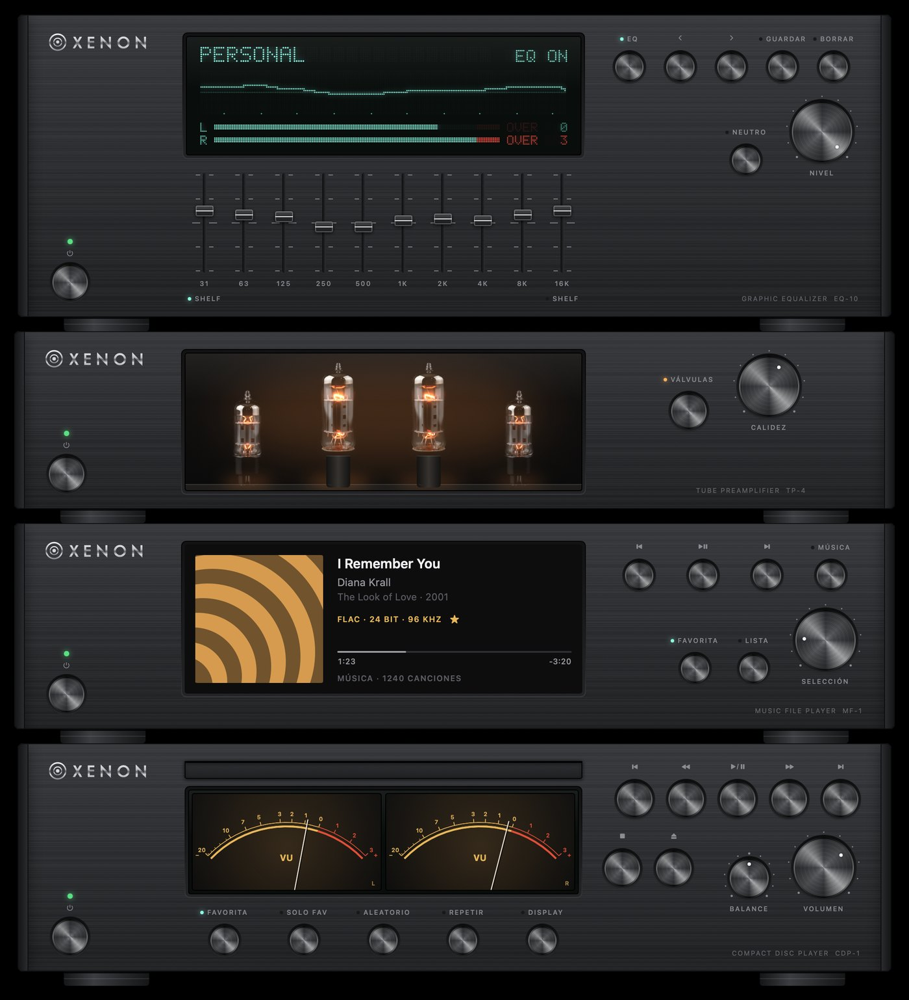
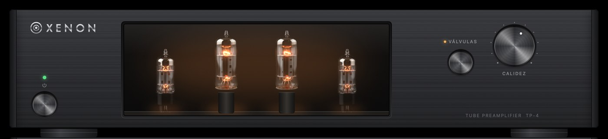
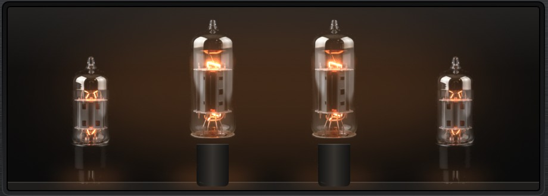

# XENON Hi-Fi

**Una torre hi-fi para el Mac: lector de CD, reproductor de archivos, previo a válvulas y ecualizador gráfico, cada uno con el aspecto y el comportamiento de un aparato de verdad.**

*[Read in English](README.md)*



XENON es una app nativa de macOS, escrita en Swift y SwiftUI, que:
- Reproduce CD físicos desde un lector USB y archivos de alta resolución (FLAC, ALAC, WAV, AIFF y MP3).
- Los enseña en una pantalla de puntitos, con vúmetros de aguja y una pantalla de portada.
- Puede dar color al sonido con una etapa de válvulas y un ecualizador de 10 bandas.

La hizo alguien que no sabe programar, conversando con un asistente de programación con IA (Claude Code). En [Cómo se hizo](docs/COMO-SE-HIZO.md) se cuenta la historia y el método.

## Los cuatro aparatos

| Aparato | Qué hace |
|---|---|
| **Compact Disc Player CDP-1** | Reproduce el CD del lector USB. Reconoce el disco por su huella (MusicBrainz) y busca una sola vez el álbum, el artista y los títulos. Lee el disco por delante en trozos grandes (memoria antisaltos), así que un lector USB lento no corta la música. Pantallas de tiempo transcurrido, tiempo restante, barras de espectro y vúmetros. Favoritas por disco, aleatorio, repetir y perilla de balance. |
| **Music File Player MF-1** | Reproduce la carpeta o el disco de música que elijas. El DAC cambia solo a la frecuencia de cada canción, así que un archivo de 24 bits y 176,4 kHz le llega intacto. Pantalla en color para la portada, listas de álbumes, canciones y carpetas, rueda con muescas, favoritas ★, y recuerda la canción y el segundo donde lo dejaste. |
| **Tube Preamplifier TP-4** | Añade la calidez de una etapa de triodo de hi-fi, sobre todo 2º armónico, sin cambiar el volumen. La perilla CALIDEZ decide cuánto. Apagado, el sonido pasa bit a bit. Cuatro válvulas fotorrealistas brillan con la música de cada canal. |
| **Graphic Equalizer EQ-10** | Diez bandas con los extremos en estantería, ajustes guardados, la curva en pantalla y medidores de pico con luces OVER que cuentan los recortes como los de estudio. |

Los aparatos se apilan en el orden en que los recorre el sonido y se mueven juntos.

<p align="center">
  <br>
  
</p>

## Cómo va el sonido

```
CD (lector USB) ─┐
                 ├─► reproductor ─► válvulas ─► ecualizador ─► volumen ─► tu DAC
Archivos ────────┘    (balance)      (TP-4)       (EQ-10)
```

- **Bit a bit con todo apagado.** La cadena trabaja a la frecuencia de la propia música, y la app pone el DAC a esa frecuencia antes de sonar. Nada se convierte por el camino.
- **Las válvulas** (`Sources/CDPlayerKit/Tube.swift`) usan una curva `tanh` con sesgo, el modelo clásico de un triodo en su punto de trabajo. Está ajustada para que el sonido flojo mantenga su nivel exacto y solo cambie el color. A frecuencias de CD trabaja a 4 veces la frecuencia, para que las notas agudas no generen tonos falsos. Al encender o apagar hace un fundido de 30 ms.
- **Los medidores enseñan lo que oyes.** Las barras, las agujas, el brillo de las válvulas y las luces OVER escuchan después del ecualizador.

Las pruebas miden todo esto (armónicos, nivel, tonos falsos y chasquidos) y están en `Tests/CDPlayerKitTests/`.

## Instalar

Necesitas:

- Un Mac con **macOS 26** (Tahoe) o posterior.
- **Xcode 26**, o solo sus herramientas de línea de comandos (`xcode-select --install`), con Swift 6.2.
- Opcional: un lector de CD/DVD USB para el reproductor de CD. El de archivos funciona sin él.

Después:

```bash
git clone https://github.com/EnriqueGPZ/xenon-hifi.git
cd xenon-hifi
./build.sh --open
```

`build.sh` compila la app, la firma y la instala como `~/Applications/CDPlayer.app`, y `--open` la arranca.

- **Firma.** Usa tu certificado Apple Development si lo tienes. Si no, firma "ad hoc": funciona, pero macOS puede volver a pedir permiso para leer el CD tras cada compilación. Para evitarlo, crea un certificado de firma de código en Acceso a Llaveros (Asistente para certificados ▸ Crear un certificado ▸ Firma de código) y pásale su nombre: `SIGN_IDENTITY="Mi Nombre" ./build.sh`.
- **Identificador.** Por defecto es `io.github.enriquegpz.xenon`. Se cambia con `BUNDLE_ID=com.tu.xenon ./build.sh`.

### Compílalo con tu IA

El repositorio trae `CLAUDE.md` y `AGENTS.md` con todo lo que necesita un asistente de programación (Claude Code, Codex, Cursor…): la estructura, cómo compilar, las pruebas, las capturas de control y las reglas de diseño. Abre la carpeta con tu asistente y pídele *«compila e instala la app»*, o que cambie lo que quieras.

## Uso

- **Lector de CD:** mete un CD. ⏯ reproduce, DISPLAY cambia la pantalla (tiempo, restante, barras y vúmetros), y los menús muestran todos los atajos.
- **Más aparatos:** desde los menús *Reproducción* y *Archivos* se abren el reproductor de archivos (⌥⌘M), el previo a válvulas (⌥⌘V) y el ecualizador (⌥⌘E).
- **Reproductor de archivos:** pulsa MÚSICA y elige el disco o la carpeta. LISTA recorre portada, álbumes, canciones y carpetas, y la rueda SELECCIÓN se mueve por ellas.
- **Válvulas:** V las enciende o apaga, y ⌥⌘↑ y ⌥⌘↓ cambian la calidez.

## Comprobar cambios

```bash
swift test --scratch-path ~/Library/Developer/CDPlayer/test-build   # pruebas de lógica y de sonido
tools/selftest.sh                                                   # funciones reales de la app, en modo prueba
tools/snap.sh                                                       # capturas claro/oscuro en /tmp/CDPlayer-shots
tools/grid-lint.sh                                                  # rejilla de 4 pt
```

Las pruebas y capturas usan un disco y una biblioteca de ejemplo, y nunca tocan tus ajustes, tu música ni tu DAC.

## Lo que no hace

- Ni streaming, ni radio por internet, ni portadas de internet.
- No pasa los CD a archivos.
- No hay descarga firmada y notarizada: se compila en cada Mac. Es la forma de que macOS deje abrir una app de fuera de la App Store sin avisos.

## Créditos

- Títulos de discos y canciones: [MusicBrainz](https://musicbrainz.org), base de datos abierta.
- Las válvulas son imágenes generadas con IA (nano-banana, vía kie.ai), separadas en capa fría y capa de luz con `tools/tube_layers.py`.
- El aspecto se inspira en los equipos hi-fi japoneses de los 90 y 2000. XENON es una marca inventada.
- Hecho con [Claude Code](https://claude.com/claude-code).

## Licencia

[MIT](LICENSE): úsalo, cámbialo y compártelo, manteniendo el aviso.
