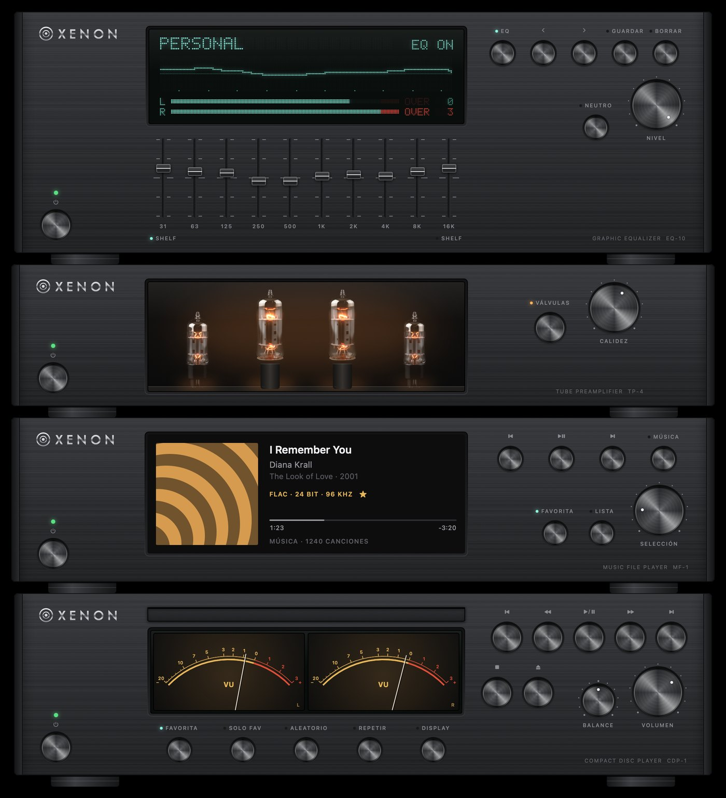
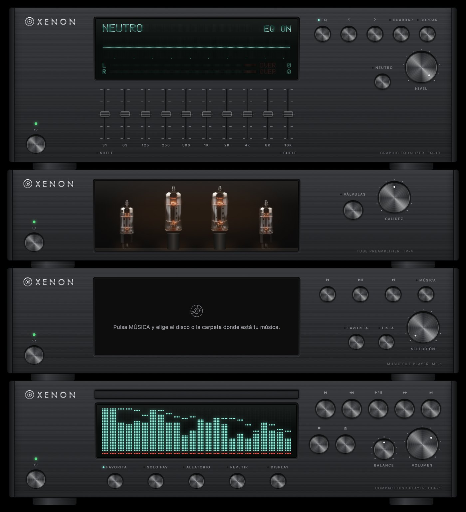
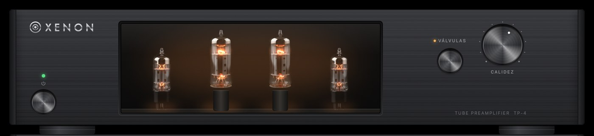
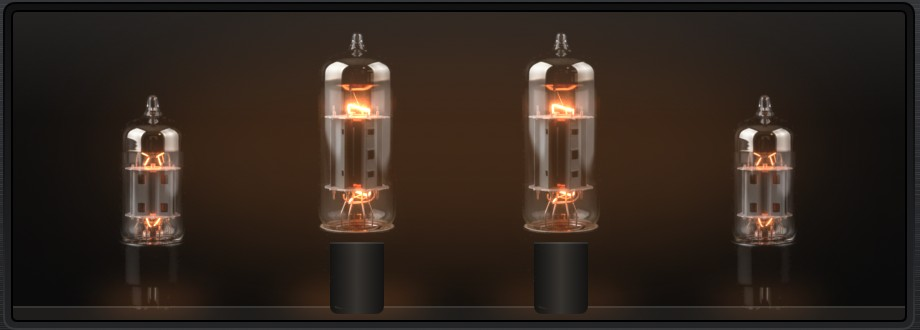
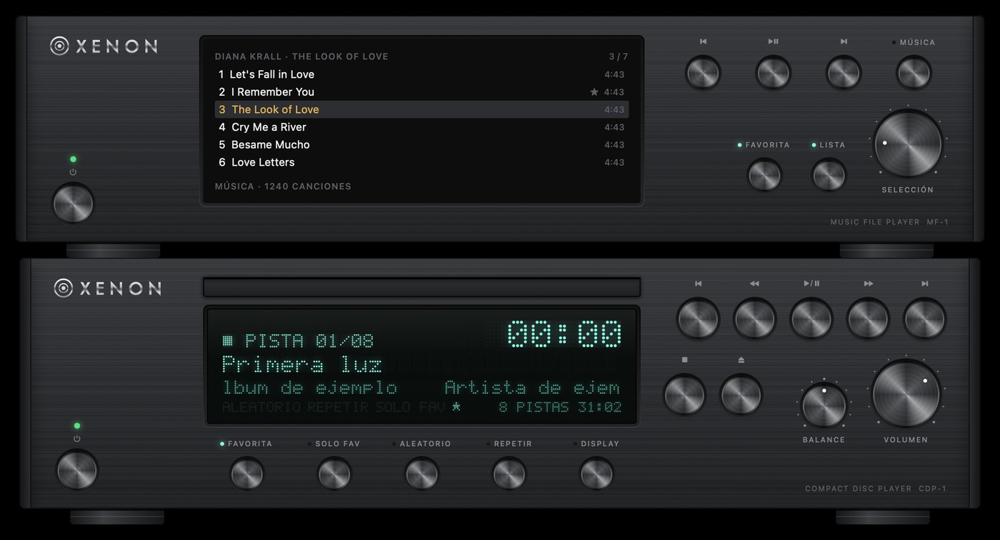

# XENON Hi-Fi

**A hi-fi stack for the Mac: a CD player, a music file player, a tube preamp and a graphic equalizer, each one built to look and behave like real audio gear.**

*[Leer en español](README.es.md)*



XENON is a native macOS app (Swift and SwiftUI) that plays physical CDs from a USB drive and high-resolution music files (FLAC, ALAC, WAV, AIFF, MP3). It shows them on a dot-matrix display, VU meters and a cover screen, and it can colour the sound with a tube stage and a 10-band equalizer.

It was made by someone who does not write code, by talking with an AI coding assistant (Claude Code). [How it was made](docs/HOW-IT-WAS-MADE.md) tells that story and the method behind it.

## The four units

| Unit | What it does |
|---|---|
| **Compact Disc Player CDP-1** | Plays the CD in a USB drive. It recognises the disc by its fingerprint (MusicBrainz disc ID) and fetches the album, artist and song titles once. It reads the disc ahead in big pieces (anti-skip memory), so a slow USB drive never cuts the music. It shows elapsed and remaining time, spectrum bars and analog VU meters. It also has favourites per disc, shuffle, repeat, and a balance knob. |
| **Music File Player MF-1** | Plays the music folder or disk you choose: FLAC, ALAC, WAV, AIFF and MP3. The DAC switches to each song's own sample rate by itself, so a 24-bit/176.4 kHz file reaches it untouched. It has a colour screen for the cover, album, song and folder lists, a selector knob with detents, ★ favourites, and it remembers the song and second where you stopped. |
| **Tube Preamplifier TP-4** | Adds the warmth of a hi-fi triode stage, mostly 2nd harmonic, without changing the loudness. A WARMTH knob sets how much. When off, the sound passes bit for bit. Four photo-real tubes glow with each channel's music. |
| **Graphic Equalizer EQ-10** | Ten bands with shelving ends, saved presets, the curve on its display, and peak meters with OVER lights that count clips the way studio meters do. |

The units stack on top of each other in the order the sound flows through them, and they move together as one.



<p align="center">
  <br>
  
</p>



## How the sound flows

```
CD (USB drive) ─┐
                ├─► player ─► tubes ─► equalizer ─► volume ─► your DAC
Music files ────┘   (balance)  (TP-4)    (EQ-10)
```

- **Bit-perfect when everything is off.** The chain runs at the music's own sample rate, and the app sets the DAC to that rate before it plays. Nothing is resampled on the way.
- **The tube stage** (`Sources/CDPlayerKit/Tube.swift`) uses a biased `tanh` curve, the classic model of a triode near its working point. It is scaled so quiet sound keeps exactly its level and only the colour changes. It runs 4× oversampled at CD rates, so high notes do not fold back as false tones. Switching it on or off fades over 30 ms.
- **Meters show what you hear.** The bars, the needles, the tube glow and the OVER lights all listen after the equalizer.

The tests measure all of this: the harmonics, the level, the folding and the clicks. They are in `Tests/CDPlayerKitTests/`.

## Install

You need:

- A Mac with **macOS 26** (Tahoe) or later.
- **Xcode 26**, or just its Command Line Tools (`xcode-select --install`), with Swift 6.2.
- Optional: a USB CD/DVD drive for the CD player. The file player works without one.

Then:

```bash
git clone https://github.com/EnriqueGPZ/xenon-hifi.git
cd xenon-hifi
./build.sh --open
```

`build.sh` compiles the app, signs it and installs it as `~/Applications/CDPlayer.app`, and `--open` starts it.

- **Signing.** It uses your Apple Development certificate if you have one. Without one, it signs "ad hoc", which works, but macOS may ask again for permission to read the CD after each new build. To avoid that, make a code-signing certificate in Keychain Access (Certificate Assistant ▸ Create a Certificate ▸ Code Signing) and pass its name: `SIGN_IDENTITY="My Name" ./build.sh`.
- **Bundle ID.** The default is `io.github.enriquegpz.xenon`. Change it with `BUNDLE_ID=com.you.xenon ./build.sh`.

### Build it with your AI

The repository includes `CLAUDE.md` and `AGENTS.md` with everything an AI coding assistant (Claude Code, Codex, Cursor…) needs: the layout, how to build, the tests, the snapshot checks and the design rules. Open the folder with your assistant and ask it to *"build and install the app"*, or to change something.

## Use

- **CD player:** put a CD in. ⏯ plays, DISPLAY changes the screen (time, remaining, bars, VU), and the menus list every shortcut.
- **More units:** the *Reproducción* and *Archivos* menus open the file player (⌥⌘M), the tube preamp (⌥⌘V) and the equalizer (⌥⌘E).
- **File player:** press MÚSICA and choose the disk or folder with your music. LISTA goes through cover, albums, songs and folders, and the SELECCIÓN knob moves through them.
- **Tubes:** V turns them on or off. ⌥⌘↑ and ⌥⌘↓ change the warmth.

The interface is in Spanish, like the panel of the gear it imitates.

## Check your changes

```bash
swift test --scratch-path ~/Library/Developer/CDPlayer/test-build   # logic and sound tests
tools/selftest.sh                                                   # the app's real functions, on a test store
tools/snap.sh                                                       # light/dark snapshots in /tmp/CDPlayer-shots
tools/grid-lint.sh                                                  # 4-pt grid check
```

Tests and snapshots use a demo disc and library and never touch your saved settings, your music or your DAC.

## What it does not do

- No streaming services, internet radio, or cover art from the internet.
- No ripping CDs to files.
- No signed and notarized download: build it yourself (that is how macOS lets an app from outside the App Store run without warnings).

## Credits

- Album and song titles: [MusicBrainz](https://musicbrainz.org) (open music database).
- The tube pictures are AI-generated (nano-banana via kie.ai) and then split into a cold layer and a light layer by `tools/tube_layers.py`.
- The look takes its inspiration from Japanese hi-fi gear of the 90s and 2000s. XENON is a made-up brand.
- Built with [Claude Code](https://claude.com/claude-code).

## License

[MIT](LICENSE): use it, change it, share it, keeping the notice.
